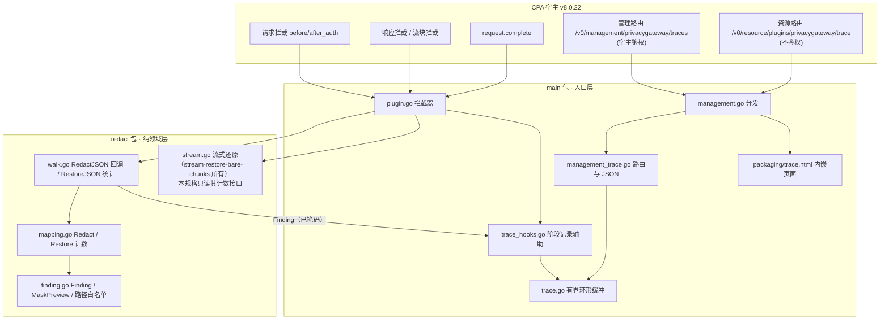
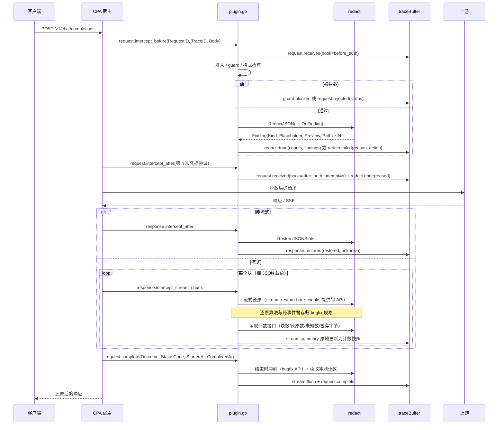

# 设计文档：请求脱敏追踪日志（CPA 管理界面内嵌）

## Overview

目标：在 CPA 管理界面中提供一个插件日志页，按请求展示从**收到请求**到**数据还原**的每一步（准入、拦截、脱敏、终止、响应还原、流式还原、请求完成）。日志中的敏感值只以**掩码预览**出现，原值和完整正文都不会离开 `redact` 包，也不会进入日志缓冲。

已确认决策：

| 编号 | 决策 | 取值 | 日期 |
|---|---|---|---|
| RT-1 | 页面形态 | 替换现有内嵌"隐私脱敏检测"面板，改为日志页，展示每个请求从接收到还原的全部步骤 | 2026-10-11 |
| RT-2 | 敏感值展示 | 掩码预览（如 `u***@example.com`、`138****5678`、`1101**********1239`、`6217********7893`、`sk-t****ABCD`）；不展示完整原值，不展示完整正文 | 2026-10-11 |
| RT-3 | 输出通道 | 只进插件内存缓冲，经管理页面查看；不写 CPA 宿主日志（现有 `logHost` 错误日志保持不变） | 2026-10-11 |
| RT-4 | 规格入口 | Design-first | 2026-10-11 |

本文新做的设计决策（编号 TD-x，供需求文档引用）：

| 编号 | 决策 | 取值 | 理由 |
|---|---|---|---|
| TD-1 | 掩码位置 | `redact` 包内纯函数 `MaskPreview`，在 `Finding` 构造时调用；原值不出 `redact` | 原值只在领域层存在，入口层拿不到就不会误记 |
| TD-2 | 数据接口 | 管理路由 `GET/DELETE /v0/management/privacygateway/traces`，不设 `Menu` | 走宿主管理鉴权；不落在宿主 `/plugins/:id/...` 参数路由树下（见 6.2） |
| TD-3 | 页面路由 | 资源路由 `Path:"trace"`、`Menu:"隐私脱敏日志"`；去掉内嵌 `panel` 资源路由 | 一个插件只保留一个菜单，避免两个入口 |
| TD-4 | 旧面板 | `packaging/panel.html` 继续打进 zip 的 `privacygateway/panel.html`，仅作 `file://` 独立排障工具，不再内嵌 | 宿主 Home 模式下资源路由不可用时仍有排障手段 |
| TD-5 | 缓冲默认值 | `trace_enabled: true`、`trace_max_requests: 200`、`trace_max_events: 64` | 用户要求开箱可见；最坏内存约 6 MiB（见 Performance） |
| TD-6 | 流式记录 | 每个请求只有一条 `stream.summary` 事件，原地累加计数，不按块追加 | 长流可达上千块，逐块记录会挤掉其他阶段事件 |
| TD-7 | 管理密钥 | 页面输入，默认只放内存；勾选"本标签页记住"才写 `sessionStorage`，永不写 `localStorage` | 页面与 CPA 同源；`sessionStorage` 随标签页关闭清除 |
| TD-8 | 关联宿主日志 | 记录宿主下发的 `TraceID`（8 位十六进制，即 gin 日志中的 `[f2fd6250]`） | 宿主源码确认拦截与完成回调都会填充（见 6.2） |
| TD-9 | `pluginMetadata` 迁移 | 从 `abi.go` 移到新文件 `metadata.go` | `abi.go` 已 499 行；腾出约 17 行给必要的单行挂钩 |
| TD-10 | 流式统计来源 | 只消费 `stream-restore-bare-chunks` 提供的计数接口；不修改 `redact/stream.go` 与 `InterceptStreamChunk` 的还原逻辑 | 2026-10-11 发现流块全丢缺陷，由独立 bugfix 规格修复并替换流式 API，避免两个规格改同一处 |

非目标：持久化到磁盘、写宿主日志、导出/下载日志、跨进程或多实例聚合、修改脱敏算法、修改宿主或管理中心前端、展示请求/响应正文片段。

### 背景：旧面板"一直在请求中"

2026-10-11 本机用 CPA v8.0.22 源码构建宿主，配合 mock 上游实测：插件已注册、`effective_enabled=true`、菜单存在；含 `user@example.com` 与 `13812345678` 的非流式对话请求以 `[[PG_57ebccde224a11c9_1]]` / `[[PG_..._2]]` 到达上游，客户端响应被还原为原值，耗时约 8 ms。请求侧脱敏链路正常。

同日确认了一个流式缺陷：请求含敏感值（存在映射）时，所有流块都被丢弃。原因是宿主对每个流块传入的是裸 JSON 载荷，不是 SSE 行；此外占位符可能被拆在相邻两个 delta 事件中，需要在文本层跨事件暂存。内容全部被丢弃后，客户端收不到任何字节，经 Cloudflare 时表现为 524。旧面板"一直在请求中"与流式 524 由这个缺陷解释，与请求侧脱敏无关。该缺陷由独立的 bugfix 规格 `.kiro/specs/stream-restore-bare-chunks/` 修复，它拥有 `redact/stream.go` 与 `plugin.go` 的 `InterceptStreamChunk`，并会替换流式还原 API。本规格的流式统计只消费该修复提供的计数接口（组件 1.4），不修改流式还原算法。

新页面的所有请求仍须带超时并显示可见错误（组件 5），避免页面自身再出现无反馈的挂起。

## Architecture



数据流向只有一条：`redact` 产出已掩码的 `Finding` 与计数 → `trace_hooks` 组装事件 → `trace` 缓冲 → 管理路由序列化输出。`redact` 不感知缓冲存在，`trace` 不感知原值存在。

### 请求生命周期与记录点



## Components and Interfaces

### 1. 领域层：`redact/finding.go`（新文件）

```go
package redact

// Finding 是一次检出的可观测描述。Raw 值不在结构体中，构造时即掩码。
type Finding struct {
    Kind        Kind   // credential / entropy / email / phone / id_card / bank_card
    Placeholder string // [[PG_<nonce>_<seq>]]，nonce 每请求随机，可展示
    Preview     string // MaskPreview(kind, raw) 的结果
    Path        string // JSON 路径的白名单渲染，例如 messages[0].content
    Reused      bool   // 同一原值在本映射中已有占位符（after_auth 重扫时常见）
}

// FindingSink 由调用方提供；nil 表示不观测，此时不构造 Finding（零开销）。
type FindingSink func(Finding)

// MaskPreview 是纯函数：按 kind 生成掩码预览。按 rune 处理，不截断多字节字符。
func MaskPreview(kind Kind, raw string) string

// RenderPath 把遍历路径渲染为白名单形式：已知协议键原样，其余键为 "*"，数组下标保留。
func RenderPath(path []string) string
```

#### 1.1 掩码规则

通用规则（所有 kind）：
1. 先把 `raw` 按 rune 解码；无效 UTF-8 字节、控制字符（`unicode.IsControl`）、换行一律视为 `?` 参与计算，输出中也显示为 `?`。
2. 掩码段用**固定个数**的 `*`（除身份证外），不暴露原值长度。
3. 输出最长 `maxPreviewRunes = 48` 个 rune，超出部分截断并以 `…` 结尾。
4. 规则判定失败（长度不足、格式不符）时退化为**仅类别标签**：`[<kind>]`，例如 `[credential]`。
5. 输出中来自原值的可见 rune 数不超过下表上限；任何情况下输出都不包含完整原值。

| Kind | 规则 | 示例输入 → 输出 | 可见原值 rune 上限 |
|---|---|---|---|
| `email` | 按最后一个 `@` 拆分。本地部分 ≥2 rune：首 rune + `***`；=1 rune：`*`。域名原样保留，域名超过 32 rune 时截为前 31 rune + `…` | `user@example.com` → `u***@example.com`；`a@b.cc` → `*@b.cc` | 1 + min(域名, 31) |
| `phone` | 只取数字；数字少于 11 位退化为 `[phone]`；取最后 11 位 `d`：`d[0:3]` + `****` + `d[7:11]`。`+86`/`0086` 前缀不展示 | `+86 13812345678` → `138****5678` | 7 |
| `id_card` | 去空白后长度为 15 或 18：前 4 + `*`×(len−8) + 后 4（身份证长度固定公开，按位数补星）；其他长度退化为 `[id_card]` | `110101199003071239` → `1101**********1239` | 8 |
| `bank_card` | 只取数字；少于 12 位退化为 `[bank_card]`；前 4 + `********` + 后 4 | `6217 0000 1234 7893` → `6217********7893` | 8 |
| `credential`（私钥） | 原值包含 `PRIVATE KEY` 时只输出 `[private_key]` | PEM 私钥 → `[private_key]` | 0 |
| `credential`（其他） | 识别已知公开前缀（`sk-`、`ghp_`/`gho_`/`ghu_`/`ghs_`/`ghr_`、`github_pat_`、`AKIA`、`ASIA`、`AIza`、`xox?-`、`eyJ`），前缀之后的部分为 body。body < 16 rune：`前缀****`（无前缀则 `[credential]`）；否则 `前缀` + body 首 1 rune + `****` + body 末 4 rune | `sk-test1234567890ABCD` → `sk-t****ABCD` | 前缀 + 5，且 ≤ body 的 1/3 |
| `entropy` | < 16 rune：`[entropy]`；否则首 2 rune + `****` + 末 2 rune | `Zx9…`(32 位) → `Zx****Q1` | 4 |
| 未知 kind | `[<kind>]`（kind 本身经 `[a-z_]{1,16}` 白名单，不符则 `[unknown]`） | — | 0 |

说明：
- 前缀不是秘密（`sk-` 等来自公开文档），显示前缀能帮助用户识别"哪个 Key 被脱敏了"。
- `credential` 的 "≤ body 的 1/3" 在 body ≥ 16 时自然成立（5/16 < 1/3）；该上限写入属性测试。
- 邮箱域名保留是 RT-2 示例要求；它是本表中唯一可能较长的可见段，因此单独设置 32 rune 上限。

#### 1.2 路径白名单

`RenderPath` 只输出以下内容，避免 JSON 键（工具参数中的键可能是用户数据）泄露：
- 数组下标：`[n]`；
- 键：属于 `textKeys ∪ structuralKeys ∪ toolArgKeys(所有格式) ∪ {messages, contents, parts, tools, tool_calls, function, functionCall, input, system}` 的原样输出，其余输出 `*`；
- 最多保留最后 8 段，前面被省略时以 `…` 开头；总长不超过 96 字节。

#### 1.3 现有 API 的扩展（向后兼容）

```go
// walk.go
type WalkOptions struct {
    Format              string
    RedactToolArguments bool
    MaxDepth            int
    OnFinding           FindingSink // 新增；nil 时行为与现在逐字节一致
}

// mapping.go —— 原 Redact 保持签名，内部转调 redactObserved(text, base, cfg, nil, nil)
func (m *Mapping) Redact(text string, base int, cfg Config) (string, int, error)

// 新增：带路径与回调的版本，供 RedactJSON 使用
func (m *Mapping) RedactObserved(text string, base int, cfg Config, path []string, sink FindingSink) (string, int, error)

// 新增：还原统计
type RestoreStats struct {
    Restored       int      // 被替换为原值的占位符个数
    Unknown        int      // 符合占位符格式但不在本映射中的个数
    UnknownSamples []string // 最多 5 个未知占位符原样（占位符本身不敏感）
}
func (m *Mapping) RestoreCounted(text string) (string, RestoreStats)
func RestoreJSONStats(body []byte, m *Mapping) ([]byte, RestoreStats, error) // RestoreJSON 改为转调并丢弃统计
```

约束：
- `Raw` 只在 `RedactObserved` 内部局部变量中出现，传给 `MaskPreview` 后即丢弃；`Finding` 不含原值字段。
- `sink == nil` 时不调用 `MaskPreview`、不渲染路径（零额外分配）。
- `sink` 的 panic 在 `redact` 内 `recover` 并丢弃，不影响返回值（观测不改变输出）。
- 计数在已有锁内累加，不新增锁。
- `redact` 仍不导入 `main` 与宿主 SDK（archtest 不变）。

#### 1.4 流式计数接口（依赖 stream-restore-bare-chunks）

流式统计依赖 stream-restore-bare-chunks 修复后提供的计数接口（块数、还原数、未知数、跨事件暂存字节、结束时冲刷）；本规格只消费该接口，不修改流式还原算法。

本规格对该接口只提出以下**消费需求**，类型名与方法名以 bugfix 规格最终实现为准（下面是占位描述，不是本规格要新增的代码）：

```go
// 由 stream-restore-bare-chunks 提供；本规格只读。
type StreamCounters struct {
    Chunks       int // 已处理的流块数
    Restored     int // 已还原为原值的占位符数
    Unknown      int // 符合占位符格式但不在映射中的个数
    CarryBytes   int // 当前跨事件暂存的文本字节数
    MaxCarry     int // 暂存字节峰值
    Flushed      bool // 是否已执行结束时冲刷
    FlushedBytes int  // 冲刷时输出（或交还宿主）的字节数
}
// 读取须并发安全、无副作用，不改变后续还原输出。
```

协作约定：
- `redact/stream.go` 与 `plugin.go` 的 `InterceptStreamChunk` 归 bugfix 规格所有；本规格不改这两处的还原逻辑。
- bugfix 合入后，本规格只在 `InterceptStreamChunk` 返回前追加一行 `stream.summary` 更新、在 `HandleRequestComplete` 冲刷后追加一行 `stream.flush` 记录。
- 若 bugfix 尚未提供计数接口，本规格的流式部分（`stream.summary`、`stream.flush`）延后实现，其余阶段不受影响。

### 2. 入口层：`trace.go`（新文件，有界环形缓冲）

```go
type traceBuffer struct {
    mu        sync.Mutex
    on        atomic.Bool          // 关闭时所有记录函数首行返回
    seq       uint64               // 全局单调序号，事件与请求更新共用
    order     []string             // 环：按首次出现顺序的 RequestID
    head, n   int                  // 环形下标与当前数量
    records   map[string]*traceRecord
    maxReqs   int
    maxEvents int
    evicted   uint64               // 被淘汰的请求数（页面提示"更早的记录已滚出"）
}

func newTraceBuffer(maxReqs, maxEvents int, enabled bool) *traceBuffer
func (b *traceBuffer) configure(maxReqs, maxEvents int, enabled bool) // 重配；缩容时淘汰最旧；关闭时清空
func (b *traceBuffer) record(id string, ev traceEvent)                // 追加事件；永不 panic、永不返回错误
func (b *traceBuffer) updateStream(id string, f func(*traceEvent))   // 原地更新 stream.summary
func (b *traceBuffer) snapshot(q traceQuery) traceSnapshot            // 锁内深拷贝，锁外序列化
func (b *traceBuffer) clear() int
```

行为：
- 全局单例 `var traces = newTraceBuffer(...)`，在 `plugin.register` 时按配置初始化，`plugin.reconfigure` 调 `configure`（与 `stateTable.takeOverFrom` 一样跨重配保留），`PrivacyGatewayPluginShutdown` 时 `clear()` 并关闭。
- 新 RequestID 到达且 `n == maxReqs` 时淘汰环中最旧的请求（即使它仍在途：其后续事件会以新记录重新出现并带 `partial=true` 标记）。O(1)。
- 单请求事件数达到 `maxEvents − 1` 后，除 `request.complete` 外的事件丢弃并累加 `dropped_events`；最后一个槽位保留给 `request.complete`，保证每条记录都有结局。
- 单请求 `Finding` 明细总数上限 `maxFindingDetails = 64`，超出只计数（`findings_truncated`），不再保存明细。
- 锁内只做切片追加与计数，不做 JSON 编码、不做 I/O、不回调宿主。
- 每个公开方法以 `defer func(){ _ = recover() }()` 兜底；记录失败静默丢弃。
- 空 RequestID（无状态路径）使用合成键 `anon-<seq>`，并标记 `anonymous=true`。

### 3. 入口层：`trace_hooks.go`（新文件，阶段记录辅助）

`plugin.go` 的每个分支只增加一行调用，例如 `p.trace(req).blocked(guardReasonKeyword, 403)`。辅助函数集中在本文件，`plugin.go` 预计增长约 30 行（353 → ~385）。

| 阶段 `stage` | 触发点 | 记录字段 | 不记录 |
|---|---|---|---|
| `request.received` | before_auth / after_auth 入口 | `hook`、`attempt`（after_auth 第 n 次）、`source_format`、`to_format`、`model`、`requested_model`、`stream`、`body_bytes`、`trace_id` | 正文、请求头、Metadata |
| `request.rejected` | 并发上限 429、缺 RequestID 400、格式不支持 415、RequestID 复用格式不一致 400 | `reason`、`status` | — |
| `guard.blocked` | 关键词命中 403、正文超限 413（fail_closed） | `reason`(`reject_keyword` / `body_too_large`)、`status`、`body_bytes`、`limit` | **命中的关键词本身**（TD-CPA-018） |
| `guard.passthrough` | 正文超限但 fail_open、格式不支持且 fail_open、空正文、格式为空 | `reason`、`action=passthrough` | — |
| `redact.done` | `RedactJSON` 成功（含 0 命中） | `findings`（总数）、`unique`、`reused`、`counts{kind:n}`、`details[]`（`Finding`）、`mapping_size`、`elapsed_us`、`stateless`（空 ID 路径） | 原值 |
| `redact.failed` | `ErrMalformedJSON` / `ErrCapacity` / `ErrFindings` / 映射分配失败 | `reason`(`malformed_json`/`capacity`/`max_findings`/`mapping_unavailable`)、`action`(`terminate`/`passthrough`)、`status` | 解析错误原文（可能含正文片段） |
| `response.restored` | `InterceptResponse` | `status_code`、`body_bytes`、`restored`、`unknown`、`unknown_samples`、`skipped`(`no_mapping`/`empty_body`/`parse_failed`) | 正文 |
| `stream.summary` | 每个流块（原地更新，TD-6） | 计数接口（组件 1.4）的快照：`chunks`、`restored`、`unknown`、`carry_bytes`、`max_carry` | 块内容、暂存文本 |
| `stream.flush` | `HandleRequestComplete` 中结束时冲刷之后 | 计数接口的冲刷字段：`flushed`、`flushed_bytes`、冲刷前的 `carry_bytes` | 暂存文本、冲刷输出内容 |
| `plugin.error` | 请求链路 panic 恢复、插件不可用、载荷解码失败 | `reason`(`panic`/`unavailable`/`decode_failed`)、`method`、`action` | panic 文本（可能含值；`logHost` 已按现状记录，RT-3 不改） |
| `request.complete` | `HandleRequestComplete` | `outcome`(`succeeded`/`failed`/`rejected`/`canceled`)、`status_code`、`duration_ms`（`CompletedAt−StartedAt`，缺失时用首事件时间）、`has_error` | `RequestCompletion.Error` 原文（可能回显上游内容） |

after_auth 说明：宿主每次凭据尝试都会调用 after_auth。已有状态时复用同一映射重扫，重复原值得到同一占位符，`Finding.Reused=true`。页面按 `attempt` 分组显示"第 n 次凭据尝试"，并汇总"新增 x 项、复用 y 项"。

`plugin.error` 挂钩需要 `abi.go` 的两处单行调用（panic 恢复与 `beginPluginCall` 失败）。`recordABIFailure(method, request, reason)` 定义在 `trace_hooks.go`，只从 `request` 中解码 `RequestID`/`TraceID` 两个字段。

### 4. 入口层：`management.go` 与 `management_trace.go`

`management.register` 响应：

```go
abiManagementRegistrationResponse{
    Routes: []abiManagementRoute{
        {Method: "GET",    Path: "/v0/management/privacygateway/traces", Description: "隐私脱敏追踪日志（JSON）"},
        {Method: "DELETE", Path: "/v0/management/privacygateway/traces", Description: "清空隐私脱敏追踪日志"},
    },
    Resources: []abiResourceRoute{{Path: "trace", Menu: "隐私脱敏日志", Description: "按请求查看脱敏与还原的每一步"}},
}

// 宿主 ManagementRoute 无 JSON tag；不编码 Handler；Menu 必须为空（GET+Menu 会被宿主当作旧式资源菜单）。
type abiManagementRoute struct {
    Method      string
    Path        string
    Description string
}
```

`management.handle` 分发（按宿主传入的完整 `Path` 精确匹配）：

| 条件 | 响应 |
|---|---|
| `Path == "/v0/management/privacygateway/traces"` 且 GET | 200 JSON（Data Models 中的 `traceResponse`） |
| 同上且 DELETE | 200 `{"cleared":n}` |
| 同上且其他方法 | 405，`Allow: GET, DELETE` |
| `Path` 归一化为 `trace`（含 `/v0/resource/plugins/privacygateway/trace` 形式）且 GET | 200 `traceHTML` |
| 同上且非 GET | 405，`Allow: GET` |
| 其他（含旧 `panel`） | 404 |
| 解码失败 | 400 |

安全关键约束：追踪数据**只**在完整路径以 `/v0/management/` 开头时返回。宿主只把资源路由表中的路径（`/v0/resource/plugins/privacygateway/...`）派发到资源处理器，这些路径不经鉴权；插件端按完整路径匹配，保证不鉴权的资源通道永远拿不到数据。

查询参数（GET）：

| 参数 | 默认 | 范围 | 含义 |
|---|---|---|---|
| `limit` | 50 | 1..`trace_max_requests` | 返回最近 N 个请求 |
| `since` | 0 | uint64 | 只返回 `updated_seq > since` 的请求（增量轮询） |
| `filter` | 空 | `findings` / `errors` | 只看有检出的请求 / 只看终止、失败、错误的请求 |

非法参数按默认值处理，不返回 400（页面容错）。

响应头：`Content-Type: application/json; charset=utf-8`、`Cache-Control: no-store`、`X-Content-Type-Options: nosniff`。

资源页响应头：

| 头 | 值 |
|---|---|
| `Content-Type` | `text/html; charset=utf-8` |
| `X-Content-Type-Options` | `nosniff` |
| `Cache-Control` | `no-store` |
| `Referrer-Policy` | `no-referrer` |
| `Content-Security-Policy` | `default-src 'none'; script-src 'unsafe-inline'; style-src 'unsafe-inline'; connect-src 'self'; base-uri 'none'; form-action 'none'` |

`connect-src` 从 `*` 收紧为 `'self'`：页面由 CPA 自身提供（iframe `src = apiBase + menu.path`），数据接口与页面同源，不再需要跨源。不设 `frame-ancestors`：管理中心可能部署在与 CPA 不同的源上，限制祖先会让 iframe 打不开；页面本身不含数据，点击劫持收益有限。

### 5. 页面：`packaging/trace.html`（新文件，go:embed）

单文件 HTML，无外部资源。结构：

```text
┌ 顶栏：管理密钥 [••••••] □本标签页记住  [连接]  状态：● 已连接 / 错误信息（aria-live=polite）
├ 工具条：自动刷新 [开/关] 间隔 3s  筛选 (全部 | 有检出 | 异常)  [清空日志]  上次刷新 12:00:03
├ 汇总：插件 v0.1.0 · enabled · fail_closed · 缓冲 37/200 · 已滚出 0
└ 请求列表（新在上）
   ▸ 12:00:01  req 3f2a…  trace [f2fd6250]  openai · stream  ✔ succeeded 200 · 812ms · 检出 2（email 1, phone 1）
      时间线：
      +0ms   request.received   before_auth · 1.2 KB
      +1ms   redact.done        2 项 · email u***@example.com → [[PG_57eb…_1]] @ messages[0].content
      +2ms   request.received   after_auth 第 1 次 · 复用 2
      +640ms stream.summary     38 块 · 还原 2 · 未知 0
      +812ms stream.flush       暂存 0 B
      +812ms request.complete   succeeded 200
```

行为约束：
- **不挂起**：所有 `fetch` 使用 `AbortController`，超时 8 秒；超时、网络错误、非 2xx 都在状态区显示具体原因（"请求超时（8s）"、"HTTP 502：插件管理处理失败"等）。同一时刻最多一个在途轮询，上一次未结束不发起下一次。
- **防封禁**：宿主对同一 IP 连续 5 次密钥错误封禁 30 分钟（`AuthenticateManagementKey`）。收到 401/403 立即停止自动刷新，清除内存与 `sessionStorage` 中的密钥（避免刷新页面后用错误密钥重试），并提示"密钥错误，已停止自动刷新以免触发宿主封禁"。
- **增量**：首轮 `since=0`，之后用响应 `next_since`；页面最多保留 `trace_max_requests` 条，按 `request_id` 合并更新。
- **隐藏暂停**：`document.hidden` 时暂停轮询，可见时立即刷新一次。
- **渲染安全**：只用 `textContent` / `createElement`，不用 `innerHTML`；模型名、占位符等一律当文本。
- **颜色语义**：终止/失败为红、fail_open 放行为橙、正常为绿、信息为灰；颜色之外同时使用图标与文字（不只靠颜色传达状态）。
- **可访问性**：所有输入有 `<label>`；请求条目为 `<details>/<summary>`，可用键盘展开；状态区 `role="status" aria-live="polite"`；错误区 `role="alert"`；焦点样式可见；对比度目标 WCAG AA（需人工复核）。
- **空态提示**：无密钥时"请输入 CPA 管理密钥"；已连接但无记录时"暂无请求。请通过 CPA 发送一次模型请求，再回到此页"；`trace_enabled=false` 时"追踪已关闭：在配置中设置 `trace_enabled: true`"；插件 `enabled=false` 时"插件总开关关闭，请求不会被脱敏，也不会被记录"。
- **清空**：二次确认后 `DELETE`，成功后清空本地列表并重置 `since`。
- **密钥存储**（TD-7）：默认只放 JS 变量；勾选后写 `sessionStorage["privacygateway.managementKey"]`；取消勾选立即删除。请求头使用 `Authorization: Bearer <key>`。

### 6. 宿主事实（CPA v8.0.22，2026-10-11 读源码）

以下 `$H` = `/home/gh/go/pkg/mod/github.com/router-for-me/!c!l!i!proxy!a!p!i/v8@v8.0.22`。

#### 6.1 管理路由注册与派发

| 事实 | 依据 | 对设计的约束 |
|---|---|---|
| `normalizeManagementRoute`：方法默认 GET、转大写；路径相对时补到 `/v0/management` 下；去尾 `/`；不得含空白、`:`、`*` | `$H/internal/pluginhost/management.go:120-154` | 路径 `/v0/management/privacygateway/traces` 合法 |
| `Handler == nil` 的路由被拒；RPC 适配器在解码后统一设置 `Handler = a` | `management.go:121`、`rpc_client.go:619-634` | 插件不编码 Handler |
| GET 且 `Menu` 非空的管理路由会被转成旧式资源路由（不鉴权） | `management.go:156-158`、`:63-68` | 数据路由**必须**不设 Menu |
| 插件路由键为 `METHOD + 精确路径`；与 `engine.Routes()` 中 `/v0/management/` 下的已注册键精确比较冲突 | `management.go:69-73`、`$H/internal/api/server_management.go:241-252` | GET 与 DELETE 分别注册 |
| 插件管理路由经 gin `NoRoute` 进入：先 `managementAvailable`（Home 模式 / 管理禁用时 404），再 `s.mgmt.Middleware()` 鉴权，最后 `ServeManagementHTTP` | `server_management.go:254-290`、`$H/internal/api/server.go:252` | 只有 gin 树中**没有匹配**的路径才会到达插件 |
| gin 树中已有 `/v0/management/plugins/:id/{enabled,config,quota,quota/reset}` 等参数路由 | `server_management.go:35-46` | 不使用 `/v0/management/plugins/privacygateway/...`：当前虽可落到 NoRoute，但宿主今后在 `:id/` 下新增同名子路由时会静默遮蔽插件路由。选 `/v0/management/privacygateway/traces`，gin 树中该前缀下无任何路由 |
| 鉴权接受 `Authorization: Bearer <key>` 或 `X-Management-Key`；远程访问还需 `allow-remote-management`；同一 IP 连续 5 次失败封禁 30 分钟 | `$H/internal/api/handlers/management/handler.go:262-330` | 页面 401/403 即停轮询 |
| `schema_version=6` 时管理响应正文不做 HTML 转义 | `rpc_schema.go` | JSON 原样输出 |

#### 6.2 请求标识

| 事实 | 依据 |
|---|---|
| `RequestInterceptRequest`、`RequestCompletion` 均含 `RequestID`（每次模型执行唯一，UUID v4）与 `TraceID`（父 HTTP 请求，8 位十六进制） | `$H/sdk/pluginapi/types.go:1131-1152`、`:1189-1202`、`:1487-1490` |
| 宿主以 `logging.GetRequestID(ctx)` 填充拦截与完成回调的 `TraceID`，即 gin 访问日志中方括号内的 ID | `$H/sdk/api/handlers/handlers_interceptors.go:128,489,551,578` |
| `ResponseInterceptRequest`、`StreamChunkInterceptRequest` 只有 `RequestID`，无 `TraceID` | `types.go:1205-1261` |
| `RequestCompletionOutcome` 取值：`succeeded`、`failed`、`rejected`、`canceled` | `types.go:1174-1186` |

结论：缓冲以 `RequestID` 为键；`TraceID` 取自 `request.received` / `request.complete`，作为显示字段。同一 HTTP 请求可能对应多个 RequestID（宿主重试/多次执行），页面可按 `trace_id` 聚类（展示层功能，非必须）。

### 7. 配置

`config.go` 新增：

```go
TraceEnabled     *bool `yaml:"trace_enabled"`      // 默认 true
TraceMaxRequests int   `yaml:"trace_max_requests"` // 默认 200，范围 1..2000
TraceMaxEvents   int   `yaml:"trace_max_events"`   // 默认 64，范围 8..256
```

- 超出范围时 `parseConfig` 返回错误（与现有字段一致：初次注册失败，重配保留旧配置）。
- `config.example.yaml` 与包内 `config.snippet.yaml`（由示例派生）同步三项。
- `pluginMetadata()` 移到 `metadata.go`（TD-9），并补 3 个 `ConfigField`。
- `trace_enabled=false`：缓冲清空并关闭；所有记录函数在 `atomic.Bool` 检查后立即返回；`WalkOptions.OnFinding` 为 nil。

### 8. 文件变更清单（实现阶段）

| 文件 | 变更 | 预计行数 |
|---|---|---|
| `redact/finding.go` | 新增 `Finding`、`FindingSink`、`MaskPreview`、`RenderPath` | ~220 |
| `redact/mapping.go` | `RedactObserved`、`RestoreCounted`；`Redact` 转调 | 412 → ~470 |
| `redact/walk.go` | `WalkOptions.OnFinding`、传递路径、`RestoreJSONStats` | 285 → ~320 |
| `redact/stream.go` | **不修改**（归 stream-restore-bare-chunks；本规格只读其计数接口） | — |
| `trace.go` | 缓冲 | ~250 |
| `trace_hooks.go` | 阶段辅助、`recordABIFailure` | ~220 |
| `management_trace.go` | 查询解析、快照、JSON | ~180 |
| `management.go` | 路由注册与分发、换页面 | 117 → ~150 |
| `metadata.go` | `pluginMetadata` 迁入 | ~35 |
| `abi.go` | 删 `pluginMetadata`；+2 行挂钩；register/reconfigure/shutdown 各 1 行缓冲调用 | 499 → ~487 |
| `plugin.go` | 每分支 1 行记录；`InterceptStreamChunk` 与流式冲刷处只在 bugfix 合入后各追加 1 行，不改还原逻辑 | bugfix 合入后的行数 + ~32 |
| `config.go` | 3 个字段 + 校验 | 238 → ~255 |
| `packaging/trace.html` | 新页面 | — |
| `scripts/smoke/check.go` | 断言资源路由改为 `trace`，新增管理路由与 GET traces 冒烟 | — |

`redact/mapping.go` 预计接近 470 行；若超过 480 行，把还原相关函数拆到 `redact/restore.go`。

## Data Models

### traceEvent（入口层，JSON 输出形状）

```go
type traceEvent struct {
    Seq     uint64         `json:"seq"`
    At      time.Time      `json:"at"`              // RFC3339Nano
    Stage   string         `json:"stage"`           // 见组件 3 的阶段表
    Level   string         `json:"level"`           // info / warn / error
    Hook    string         `json:"hook,omitempty"`  // before_auth / after_auth / response / stream / complete / abi
    Attempt int            `json:"attempt,omitempty"`
    Reason  string         `json:"reason,omitempty"` // 固定枚举
    Action  string         `json:"action,omitempty"` // terminate / passthrough / redact / restore
    Status  int            `json:"status,omitempty"`
    Fields  traceFields    `json:"fields"`
}

type traceFields struct {
    SourceFormat   string          `json:"source_format,omitempty"`
    ToFormat       string          `json:"to_format,omitempty"`
    Model          string          `json:"model,omitempty"`           // ≤64 字节，控制字符替换
    Stream         *bool           `json:"stream,omitempty"`
    BodyBytes      int             `json:"body_bytes,omitempty"`
    Limit          int             `json:"limit,omitempty"`
    Findings       int             `json:"findings,omitempty"`
    Unique         int             `json:"unique,omitempty"`
    Reused         int             `json:"reused,omitempty"`
    Counts         map[string]int  `json:"counts,omitempty"`          // 键 ∈ Kind 枚举
    Details        []traceFinding  `json:"details,omitempty"`
    Restored       int             `json:"restored,omitempty"`
    Unknown        int             `json:"unknown,omitempty"`
    UnknownSamples []string        `json:"unknown_samples,omitempty"` // ≤5，均匹配占位符正则
    Chunks         int             `json:"chunks,omitempty"`        // 以下 6 项来自流式计数接口（组件 1.4）
    CarryBytes     int             `json:"carry_bytes,omitempty"`
    MaxCarry       int             `json:"max_carry,omitempty"`
    Flushed        bool            `json:"flushed,omitempty"`
    FlushedBytes   int             `json:"flushed_bytes,omitempty"`
    ElapsedUS      int64           `json:"elapsed_us,omitempty"`
    DurationMS     int64           `json:"duration_ms,omitempty"`
    Outcome        string          `json:"outcome,omitempty"`
}

type traceFinding struct {
    Kind        string `json:"kind"`
    Placeholder string `json:"placeholder"`
    Preview     string `json:"preview"`
    Path        string `json:"path,omitempty"`
    Reused      bool   `json:"reused,omitempty"`
}
```

校验规则：
- `Stage`、`Level`、`Hook`、`Reason`、`Action`、`Outcome` 只取代码内常量，不拼接外部字符串。
- 唯一来自外部的自由文本是 `Model`、`SourceFormat`、`ToFormat`、`TraceID`：截断 64 字节，替换控制字符；`TraceID` 额外校验 `^[0-9A-Za-z-]{1,64}$`，不符则丢弃。
- `Preview` 只来自 `redact.MaskPreview`；`Placeholder` 与 `UnknownSamples` 必须匹配 `\[\[PG_[0-9a-f]{16}_[0-9]{1,9}\]\]`。

### traceRecord（每请求）

```go
type traceRecord struct {
    RequestID     string       `json:"request_id"`
    TraceID       string       `json:"trace_id,omitempty"`
    Anonymous     bool         `json:"anonymous,omitempty"`
    Partial       bool         `json:"partial,omitempty"` // 早期事件已随淘汰丢失
    FirstSeen     time.Time    `json:"first_seen"`
    UpdatedSeq    uint64       `json:"updated_seq"`
    Outcome       string       `json:"outcome,omitempty"`  // 完成前为空 = 在途
    Status        int          `json:"status,omitempty"`
    Terminated    bool         `json:"terminated,omitempty"`
    HasError      bool         `json:"has_error,omitempty"`
    FindingTotal  int          `json:"finding_total"`
    Counts        map[string]int `json:"counts,omitempty"`
    DroppedEvents int          `json:"dropped_events,omitempty"`
    FindingsTruncated int      `json:"findings_truncated,omitempty"`
    Events        []traceEvent `json:"events"`
}
```

### traceResponse（GET 返回）

```json
{
  "version": 1,
  "plugin": {"version": "0.1.0", "enabled": true, "fail_closed": true, "trace_enabled": true},
  "limits": {"max_requests": 200, "max_events": 64, "max_finding_details": 64},
  "buffered": 37,
  "evicted": 0,
  "next_since": 1824,
  "requests": [ /* traceRecord，按 FirstSeen 倒序，至多 limit 条 */ ]
}
```

| 名称 | 形状 | 说明 |
|---|---|---|
| 数据路由 | `GET`/`DELETE /v0/management/privacygateway/traces` | 宿主鉴权 |
| 页面路由 | `GET /v0/resource/plugins/privacygateway/trace` | 不鉴权，静态内容 |
| 菜单 | `隐私脱敏日志` | 替换 `隐私脱敏检测` |
| 配置键 | `trace_enabled` / `trace_max_requests` / `trace_max_events` | 组件 7 |

## Correctness Properties

*属性是在系统所有合法执行中都应成立的特征，是对系统应做什么的形式化陈述，连接人类可读的规格与机器可验证的正确性保证。*

> 需求编号对应 `requirements.md`（2026-10-11 回填）。

### Property 1: 掩码不泄露完整原值

对于任意 kind 与任意被检测器判定为该 kind 的字符串 raw（生成器可在其中混入多字节字符与相邻噪声），`MaskPreview(kind, raw)` 的输出不等于 raw，且不包含 raw 作为子串。

**Validates: Requirements 2.6, 1.9, 2.4**

### Property 2: 掩码可见字符上限

对于任意 kind 与 raw，`MaskPreview` 输出中来自 raw 的可见 rune 数不超过组件 1.1 表中该 kind 的上限，输出总长不超过 48 rune，且输出是合法 UTF-8、不含控制字符。

**Validates: Requirements 2.1, 2.2, 2.3, 1.3, 1.10**

### Property 3: 掩码格式示例一致

对于任意合法手机号、18 位身份证、12~19 位银行卡与带已知前缀的凭据，`MaskPreview` 的输出分别匹配 `^1[3-9]\d\*{4}\d{4}$`、`^.{4}\*{10}.{4}$`、`^\d{4}\*{8}\d{4}$`、`^<前缀>.\*{4}.{4}$`；私钥恒为 `[private_key]`。

**Validates: Requirements 1.4, 1.5, 1.6, 1.7, 1.8, 2.7**

### Property 4: 追踪数据不含原值

对于任意 JSON 请求体（随机嵌入生成的邮箱、手机号、身份证、银行卡、凭据、高熵串），经插件请求拦截、响应还原与流式还原后，`GET traces` 返回的 JSON 字节（及其 JSON 转义形式）都不包含任何检出项的原值子串。

**Validates: Requirements 5.1, 5.2, 5.3, 5.6**

### Property 5: 观测不改变输出

对于任意请求体、映射与配置，`RedactJSON` 在 `OnFinding = nil`、`OnFinding = 正常收集器`、`OnFinding = 会 panic 的收集器` 三种情况下返回的字节、计数与错误完全相同；`trace_enabled` 为 true 或 false 时插件四个拦截器的返回值也完全相同。

**Validates: Requirements 4.4, 4.5, 7.7**

### Property 6: 回调与计数一致

对于任意请求体，`OnFinding` 被调用的次数等于各字符串 `Mapping.Redact` 替换次数之和（即实际写入输出的占位符个数），每个 `Finding.Placeholder` 都出现在输出字节中且 `mapping.Has(Placeholder)` 为真；`Reused` 为真当且仅当该占位符在本次调用前已存在于映射中。

**Validates: Requirements 4.1, 4.3**

### Property 7: 还原统计正确

对于任意映射与任意由已知占位符、未知同格式占位符、普通文本拼接成的字符串，`RestoreCounted` 的结果字符串等于 `Restore` 的结果，`Restored` 等于已知占位符出现次数，`Unknown` 等于未知占位符出现次数，`UnknownSamples` 长度不超过 5；`RestoreJSONStats` 返回的字节与 `RestoreJSON` 相同。

**Validates: Requirements 4.6, 4.7**

### Property 8: 记录流统计不改变流输出

对于任意含占位符的流块序列（每块为宿主下发的裸 JSON 载荷，占位符可被随机拆在相邻 delta 事件中），经 stream-restore-bare-chunks 提供的流式还原 API 处理时，记录流统计（`trace_enabled=true`）与不记录（`trace_enabled=false`）两种情况下每块输出与结束冲刷输出逐字节相同；记录时该请求至多一条 `stream.summary`，其 `chunks`、`restored`、`unknown`、`carry_bytes`、`max_carry` 等于计数接口在最后一块之后返回的值。

**Validates: Requirements 9.2, 9.3, 9.5**

### Property 9: 缓冲上界

对于任意 `maxReqs ∈ [1,2000]`、`maxEvents ∈ [8,256]` 与任意（含并发）记录、重配、清空操作序列，任意时刻缓冲中的请求数 ≤ `maxReqs`，任意请求的事件数 ≤ `maxEvents`，任意请求的 `Finding` 明细数 ≤ 64。

**Validates: Requirements 6.1, 6.4, 6.6, 6.10, 7.3**

### Property 10: 淘汰顺序与结局保留

对于任意操作序列，被淘汰的请求总是环中首次出现最早的请求；对于任意已记录 `request.complete` 的请求（且未被淘汰），其事件列表的最后一个事件是 `request.complete`，即使之前因上限丢弃了事件。

**Validates: Requirements 6.2, 6.5, 7.3**

### Property 11: 请求内事件有序

对于任意请求记录，其事件的 `Seq` 严格递增、`At` 单调不减；`next_since` 不小于返回的任意 `updated_seq`；以 `since = next_since` 再次查询且期间无新事件时返回空列表。

**Validates: Requirements 6.7, 11.4, 11.8**

### Property 12: 管理分发与数据隔离

对于任意 `ManagementRequest`（任意方法、任意路径），`management.handle` 不 panic；仅当完整路径等于 `/v0/management/privacygateway/traces` 时响应中才可能包含追踪数据；任何以 `/v0/resource/` 开头或归一化为相对路径的请求，响应正文要么是 `traceHTML`，要么是固定的短错误文本。

**Validates: Requirements 12.1, 12.7, 12.8**

### Property 13: 查询参数容错

对于任意 `limit`、`since`、`filter` 字符串组合，GET 返回 200 和合法 JSON；返回请求数不超过 `min(limit 合法值, buffered)`；`filter=findings` 时每条记录 `finding_total > 0`，`filter=errors` 时每条记录 `terminated || has_error || outcome ∈ {failed, rejected, canceled}`。

**Validates: Requirements 11.2, 11.3, 11.5, 11.6, 11.7**

### Property 14: 路径白名单渲染

对于任意 JSON 路径（任意键字符串与下标），`RenderPath` 的输出只由白名单键、`*`、`[n]`、`.`、前导 `…` 组成，段数 ≤ 8，长度 ≤ 96 字节。

**Validates: Requirements 3.1, 3.2, 3.3, 3.4**

## Error Handling

| 场景 | 行为 |
|---|---|
| 记录函数内部 panic | `recover` 后丢弃该事件；不影响拦截返回值；不写宿主日志（RT-3） |
| `OnFinding` 回调 panic | `redact` 内 `recover`，脱敏结果照常返回（Property 5） |
| 缓冲满（请求数） | 淘汰最旧请求，`evicted++`；被淘汰请求的后续事件新建记录并标记 `partial` |
| 单请求事件超限 | 丢弃非结局事件，`dropped_events++`；保留 `request.complete` 槽位 |
| 明细超限 | 只计数，`findings_truncated++` |
| `trace_*` 配置越界 | `parseConfig` 返回错误；初次注册失败、重配保留旧配置（与现有字段一致） |
| 重配缩小 `trace_max_requests` | `configure` 淘汰最旧记录直至满足新上限 |
| `trace_enabled=false` | 清空缓冲；GET 返回 `trace_enabled:false` 与空列表；页面显示关闭提示 |
| 管理请求解码失败 | 400 短文本，不 panic |
| 管理处理内部异常 | 现有 `recover` 返回 500，避免宿主熔断插件 |
| 插件 shutdown 中 | `management.*` 返回错误信封（现有行为）；缓冲已清空 |
| 页面请求超时 | 8 秒中止，显示"请求超时"，下一轮照常发起 |
| 页面 401/403 | 停止自动刷新、清除内存密钥、提示可能触发宿主封禁 |
| 页面 404（数据路由不存在） | 提示"插件版本过旧或未注册管理路由，请确认已替换 .so 并重启 CPA" |
| 页面 502 | 提示"插件管理处理失败（宿主返回 502），请查看 CPA 日志" |
| 宿主 Home 模式 | 资源与管理路由都不可用；README 提示改用包内 `panel.html` 做独立排障 |

## Testing Strategy

### 单元测试（`make test`）

| 对象 | 用例 |
|---|---|
| `MaskPreview` | 组件 1.1 表中每行示例；本地部分 1 rune 的邮箱；`+86`/`0086` 手机；15 位身份证；11 位数字银行卡退化；无前缀短凭据；PEM 私钥；中文、emoji、无效 UTF-8 输入 |
| `RenderPath` | 白名单键、用户自定义键变 `*`、超过 8 段截断 |
| `RedactObserved` / `RedactJSON` | 回调字段正确；`Reused` 在 after_auth 重扫时为真；`OnFinding=nil` 时与现行为逐字节一致（复用现有测试） |
| `RestoreCounted` / `RestoreJSONStats` | 已知/未知/外来 nonce 占位符计数 |
| 流式计数消费 | 用 bugfix 提供的 API：跨事件占位符时 `stream.summary` 计数与接口一致；冲刷后 `stream.flush` 字段与接口一致；启用/关闭追踪时流输出逐字节相同 |
| `traceBuffer` | 淘汰、事件上限保留 complete 槽、明细上限、重配缩容、关闭清空、`since` 增量、过滤 |
| 拦截器挂钩 | 每个阶段表行至少一个用例：关键词 403（断言事件中**不含**关键词）、超限 413、fail_open 放行、415、429、空 RequestID、ErrCapacity、ErrFindings、malformed JSON、panic 恢复、非流式还原、流式汇总、complete |
| `management.handle` | 路由注册 JSON 字段名为 `Method/Path/Description` 且无 `Menu`/`Handler`；资源路由 `trace` + 菜单名；GET/DELETE/405/404/400；资源路径不返回数据；响应头与 CSP |
| 配置 | 默认值、越界报错、`config.example.yaml` 与 `ConfigFields` 键集合一致 |
| 页面 | `traceHTML` 与 `packaging/trace.html` 字节相等；不含 `http://`/`https://` 外部资源引用；不含 `innerHTML`；含 `AbortController` |

### 属性测试

- 库：Go 标准库 `testing/quick` 与 `testing.F` 模糊测试（项目现有 `redact/fuzz_test.go` 已使用），不引入新依赖。
- 每个属性至少 100 次迭代；测试注释标注 `Feature: request-trace-log, Property N: <标题>`。
- Property 1~3、14 在 `redact` 包；Property 5~7 在 `redact` 包（Property 5 的拦截器部分在 main 包）；Property 4、8~13 在 main 包。Property 8 使用 stream-restore-bare-chunks 合入后的流式 API，在其合入前不实现。
- Property 4 的生成器：随机 JSON 结构（`messages[].content`、`input`、工具参数）中嵌入随机生成的合法敏感值（Luhn 合法银行卡、校验位合法身份证、随机凭据前缀 + 随机 body），驱动完整拦截链后对 `GET traces` 的输出做子串检查。
- Property 9 用 `-race` 并发写入、重配与快照。

### 冒烟与集成

- `make smoke`：断言 `management.register` 返回 2 条管理路由与资源路由 `trace`；`management.handle` GET `trace` 返回 HTML；GET traces 在一次脱敏请求后返回包含 `redact.done` 且不含原邮箱的 JSON。
- 真实宿主（用户执行）：替换 `.so` 重启后，管理中心出现"隐私脱敏日志"菜单；页面输入密钥后能看到一次对话请求的完整时间线；记录 `TraceID` 与 gin 日志方括号 ID 是否一致。

## Performance Considerations

- 关闭追踪：每个挂钩一次 `atomic.Bool` 读取；`OnFinding` 为 nil，`redact` 不做掩码与路径渲染。
- 开启追踪：每个检出项一次掩码（O(len(raw))）和一次路径渲染；每个阶段一次加锁追加。流块只做原地计数更新，不分配新事件。
- 内存估算（默认值，最坏情况）：单事件约 300 B，单条明细约 150 B；单请求 ≤ 64 × 300 B + 64 × 150 B ≈ 29 KiB；200 个请求 ≈ 5.7 MiB。上限值（2000 × 256 事件）约 160 MiB，因此在 README 中注明调大上限的内存代价。
- 快照在锁内深拷贝、锁外编码；页面每 3 秒一次增量查询，`since` 使未变化的请求不重复传输。

## Security Considerations

- 追踪内容属于敏感元数据（谁在何时发了含哪类敏感信息的请求），只经宿主鉴权的管理路由提供；不鉴权的资源路由只提供不含数据的静态页面（Property 12）。
- 原值不进入 `main` 包的任何结构：`Finding` 无原值字段，掩码在 `redact` 内完成（TD-1）。
- 不记录：请求/响应正文、请求头（含 `Authorization`）、`Metadata`、命中的拒绝关键词、`allowlist`、解析错误原文、panic 文本、`RequestCompletion.Error`。
- 占位符 nonce 为每请求随机值，脱离映射不可逆，可以展示。
- 只存内存、有界；shutdown 与 `trace_enabled=false` 时清空；不写磁盘、不写宿主日志（RT-3）。
- 页面：CSP 禁止外部资源，`connect-src 'self'`；只用 `textContent` 渲染；密钥默认不落存储；401/403 停止轮询，避免触发宿主 IP 封禁。
- `DELETE` 只清空插件自身内存缓冲，影响范围限于诊断数据，同样需要管理鉴权。

## Dependencies

- Go 标准库：`sync`、`sync/atomic`、`unicode/utf8`、`unicode`、`encoding/json`、`time`、`net/url`、`testing/quick`。
- 宿主 SDK `github.com/router-for-me/CLIProxyAPI/v8@v8.0.22`：`sdk/pluginapi`（`ManagementRequest`/`ManagementResponse`/`RequestCompletion` 等，仅 main 包使用）。
- 无新增第三方依赖；页面无外部资源。
- 规格依赖：`.kiro/specs/stream-restore-bare-chunks/`（bugfix）。它拥有 `redact/stream.go` 与 `plugin.go` 的 `InterceptStreamChunk`，提供流式计数接口（组件 1.4）；本规格的流式事件在其合入后实现。

## 未决事项

| 项 | 状态 | 下一步 |
|---|---|---|
| iframe 能否复用管理中心已保存的管理密钥 | 未知 | 读管理中心源码中密钥的存储位置与格式（`localStorage` 键名、是否加密），确认 iframe 同源可读后再决定是否自动带入；在确认前维持手动输入（TD-7） |
| after_auth 多次凭据尝试的展示 | 方案已定（按 `attempt` 分组） | 真实宿主上观察一次多凭据重试，确认 attempt 计数与宿主重试次数一致 |
| `TraceID` 与 gin 日志 ID 一致性 | 源码确认由 `logging.GetRequestID(ctx)` 填充 | 真实宿主验收时对照一次 |
| 流式还原与计数接口 | 依赖 `stream-restore-bare-chunks`（并行编写中） | 该规格合入并提供计数接口（块数、还原数、未知数、跨事件暂存字节、结束时冲刷）后，再实现 `stream.summary` / `stream.flush`；接口名以 bugfix 实现为准 |
| 旧面板"一直在请求中"根因 | 已定位（2026-10-11）：存在映射时流块全部被丢弃，客户端无字节 → Cloudflare 524 | 由 `stream-restore-bare-chunks` 修复；修复后在真实宿主上用新页面时间线复核 |

## 文档同步

- `docs/exec-plans/active/request-trace-log.md`：记录 RT-1~RT-4 与 TD-1~TD-9，状态"设计阶段"，并在 `docs/index.md` 登记（本次已完成）。
- `docs/design-docs/abi-contract.md`：`management.register` 新增管理路由线格式（`Method/Path/Description`，不设 Menu）、`management.handle` 按完整路径分发规则、`traces` 响应 JSON 结构。
- `docs/design-docs/core-beliefs.md`：在红线一节补充"追踪日志只含掩码预览"一条。
- `ARCHITECTURE.md`：入口层补 `trace.go`、`trace_hooks.go`、`management_trace.go`、`metadata.go`；领域层补 `finding.go`；数据流补"观测旁路"。
- `AGENTS.md`：目录地图补新文件，`management.go` 职责改为"内嵌日志页 + 追踪数据路由"。
- `packaging/README.md`：菜单名改为"隐私脱敏日志"，说明 `trace_*` 配置与内存代价，`panel.html` 改为独立排障工具。
- `docs/QUALITY_SCORE.md`：新增"可观测性"一行，实现与真实宿主验收前标为"设计阶段"。
- `.kiro/specs/plugin-package/design.md`：组件 6 注明内嵌页面已被本规格替换。
